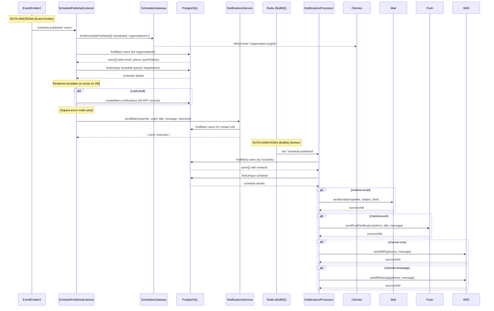

# Flujo de Notificaciones - Publicación de Horario

```mermaid
sequenceDiagram
    actor Admin as Admin/Supervisor
    participant Ctrl as SchedulesPublicationController
    participant Svc as SchedulePublicationService
    participant DB as PostgreSQL (Prisma)
    participant Queue as Redis (BullMQ)
    participant Events as EventEmitter2
    participant WS as SchedulesGateway (WebSocket)
    participant Listener as SchedulePublishedListener
    participant NSSvc as NotificationsService
    participant Worker as NotificationsProcessor (BullMQ Worker)
    participant Mail as MailService (Nodemailer)
    participant Push as PushNotificationsService (FCM/Expo)
    participant SMS as SmsNotificationsService (Twilio)

    Admin->>Ctrl: PATCH /api/v1/schedules-publication/:id/publish
    Ctrl->>Svc: publish(id, dto, user)
    
    Note over Svc: 1. Verificación y Pre-validaciones
    Svc->>DB: findUnique schedule + entries + department
    DB-->>Svc: scheduleExists (with nurseIds, organizationId)
    
    alt already PUBLISHED && !forcePublish
        Svc-->>Ctrl: throw BadRequestException
    end
    
    Note over Svc: 2. Validación y Snapshot (opcional)
    opt validateBeforePublish
        Svc->>Svc: validationService.validateSchedule(id)
    end
    opt createVersionSnapshot
        Svc->>Svc: versionService.createSnapshot(id)
    end
    
    Note over Svc: 3. Transacción Atómica
    Svc->>DB: $transaction([
        update schedule → PUBLISHED,
        create ActivityLog
    ])
    DB-->>Svc: publishedSchedule
    
    Note over Svc: 4. BullMQ Job (async)
    opt notifyStaff && nurseIds.length > 0
        Svc->>Queue: notificationsQueue.add("schedule-published", {
            scheduleId, nurseIds,
            channels: { email, push, sms, whatsapp }
        })
    end
    
    Note over Svc: 5. Evento Interno (sync)
    Svc->>Events: emit("schedule.published", {
        scheduleId, organizationId,
        publishedById, publishedAt, notifyStaff
    })
    
    Svc-->>Ctrl: return publishedSchedule
    Ctrl-->>Admin: Response 200 OK
```

---

## Procesamiento en Paralelo



---

## Arquitectura General

```mermaid
graph TB
    subgraph "API Layer"
        CTRL[SchedulesPublicationController]
    end
    
    subgraph "Service Layer"
        SVC[SchedulePublicationService]
        VAL[ScheduleValidationService]
        VER[ScheduleVersionService]
    end
    
    subgraph "Database"
        PG[(PostgreSQL<br/>Prisma ORM)]
    end
    
    subgraph "Message Queue"
        REDIS[(Redis)]
        Q[BullMQ Queue<br/>"notifications"]
    end
    
    subgraph "Event System"
        EE[EventEmitter2]
    end
    
    subgraph "Notification Listeners"
        LSN[SchedulePublishedListener]
        LSN --> NSSVC[NotificationsService]
        LSN --> WS[WebSocket Gateway]
        LSN --> PG
    end
    
    subgraph "Background Workers"
        WKR[NotificationsProcessor]
        WKR --> ML[MailService<br/>Nodemailer]
        WKR --> PSH[PushNotificationsService<br/>FCM / Expo]
        WKR --> SMS[SmsNotificationsService<br/>Twilio]
    end
    
    subgraph "Delivery Channels"
        EMAIL[📧 Email]
        PUSH[📱 Push Notification]
        SMS2[💬 SMS]
        WA[💬 WhatsApp]
        IN_APP[🔔 In-App<br/>WebSocket + DB]
    end
    
    CTRL --> SVC
    SVC --> VAL
    SVC --> VER
    SVC --> PG
    SVC --> Q
    SVC --> EE
    
    EE --> LSN
    
    Q --> WKR
    
    ML --> EMAIL
    PSH --> PUSH
    SMS --> SMS2
    SMS --> WA
    WS --> IN_APP
    NSSVC --> PG
    PG --> IN_APP
    
    style EMAIL fill:#e74c3c,color:#fff
    style PUSH fill:#3498db,color:#fff
    style SMS2 fill:#2ecc71,color:#fff
    style WA fill:#25D366,color:#fff
    style IN_APP fill:#f39c12,color:#fff
```

---

## Diagrama de Estados del Schedule

```mermaid
stateDiagram-v2
    [*] --> DRAFT
    DRAFT --> GENERATING: Generar
    GENERATING --> GENERATED: Auto-generación completa
    GENERATED --> DRAFT: Rechazar
    GENERATED --> APPROVED: Aprobar
    APPROVED --> PUBLISHED: Publicar
    PUBLISHED --> DRAFT: forcePublish
    
    state PUBLISHED {
        [*] --> NotifyStaff
        NotifyStaff --> BullMQ_Job: Encolar trabajo
        NotifyStaff --> EventEmitter: Disparar evento
        
        state BullMQ_Job {
            [*] --> LookupUsers
            LookupUsers --> SendEmail
            LookupUsers --> SendPush
            LookupUsers --> SendSMS
            LookupUsers --> SendWhatsApp
        end
        
        state EventEmitter {
            [*] --> WebSocketRealtime
            WebSocketRealtime --> CreateInAppNotifications
            CreateInAppNotifications --> MultiChannelDispatch
        end
    end
```
